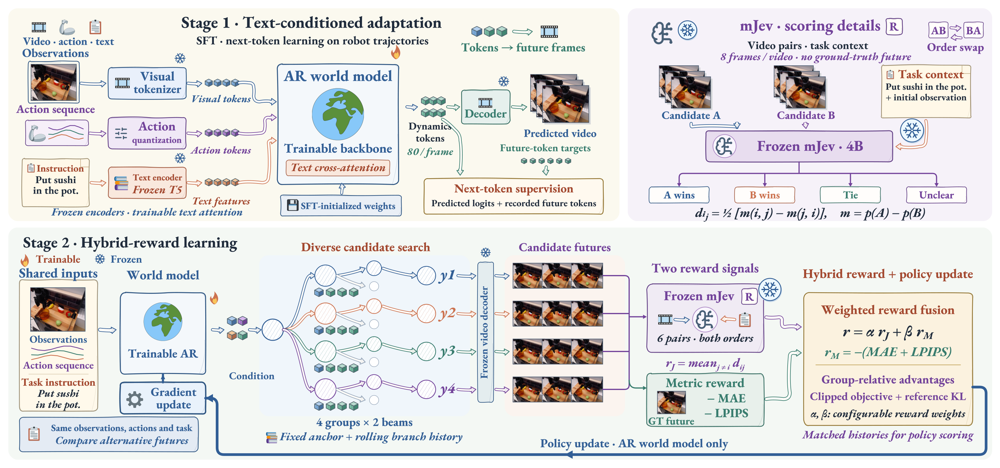
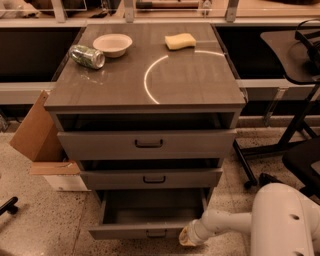
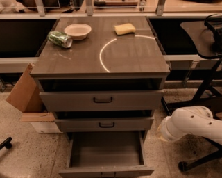
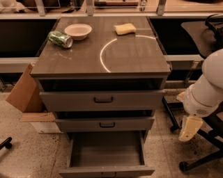
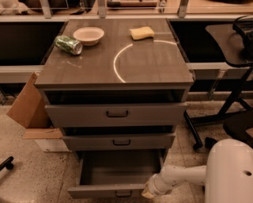

<div align="center">


# RoboImagine

### Learning Robotic World Models with Semantic and Visual Feedback

**通过比较候选未来，学习机器人世界模型。**

Hao Wu<sup>1</sup> · Yuqi Li<sup>2</sup> · Yizhou Zhao<sup>1</sup> · Kun Wang<sup>3</sup> · Xiao Luo<sup>4</sup> · Yu Cheng<sup>3</sup><br>
Yingli Tian<sup>2</sup> · Laszlo A. Jeni<sup>1</sup> · Ming-Hsuan Yang<sup>5</sup>

<sup>1</sup> Carnegie Mellon University · <sup>2</sup> The City College of New York<br>
<sup>3</sup> NTU · <sup>4</sup> University of Wisconsin–Madison · <sup>5</sup> UC Merced

[**模型与样例**](https://huggingface.co/easylearning/RoboImagine) · [**推理 Notebook**](notebooks/Inference.ipynb) · [**原始实验代码**](experiments/executed_sources/README.zh-CN.md) · [**English**](README.md)

[研究概览](#研究概览) · [方法框架](#方法框架) · [代表性结果](#代表性结果) · [快速开始](#快速开始) · [论文复现](#论文复现)

</div>

## 研究概览

机器人预测既需要**视觉保真度**，也需要准确刻画**与任务相关的动态变化**。RoboImagine 面向 GPT 风格的自回归机器人世界模型，在共享观测、动作和指令条件下，通过比较候选未来进行后训练。

框架联合设计三个组件：

- **分组多样化束搜索（GDBS）**：构造具有差异的候选轨迹，为比较提供基础。
- **互补语义与视觉反馈**：联合评价任务进展与像素、感知层面的视觉一致性。
- **保持历史一致的策略优化**：在候选实际生成时使用的分支上下文下，调整其 token 概率。

本仓库提供 **RT-1、BridgeV2 和 RoboCasa** 的主模型与对应 SFT 初始化，以及论文训练和评价所使用的原始实验程序。

## 方法框架



1. **监督初始化。** 冻结的视觉编解码器将场景与动态状态量化为离散 token；因果 Transformer 联合视觉—动作 token 与冻结 T5 编码的指令特征，通过 SFT 训练主干及文本交叉注意力，学习未来动态 token 的预测。
2. **分组多样化束搜索。** 在共享观测、动作和指令条件下，使用四组、每组两个 beam 构造候选。跨组 token 重叠惩罚鼓励差异，每组保留一条完整轨迹。
3. **互补反馈。** 冻结的 4B mJev（正文简称 Jev）依据任务上下文及每个视频的八帧，双向比较候选的任务进展；视觉反馈为 MAE 与 VGG-LPIPS 之和的负值。两类得分在候选集合内分别标准化，再以 0.25 和 0.75 的权重融合。
4. **保持历史一致的策略优化。** 组内相对优势调整候选 token 的概率，并向冻结的 SFT 策略正则化。评分时重放各分支实际使用的生成前缀。固定初始上下文、观测动态锚点与最近六帧状态—动作历史共同构成输入；六帧限制输入历史，不限制输出视频长度。

评估使用逐帧、宽度为四的普通束搜索，无需反馈评价器或真实未来帧。[框架图 PDF](docs/assets/method-overview.pdf) · [实际训练与奖励代码](experiments/executed_sources/rt1_hybrid/README.md)

## 代表性结果

### 三个数据集的预测质量

论文表 2 报告的 RoboImagine 32 帧预测结果：

| 数据集 | PSNR ↑ | SSIM ↑ | LPIPS ↓ |
|:--|--:|--:|--:|
| RT-1 | **22.57** | **0.8035** | **0.1541** |
| BridgeV2 | **21.53** | **0.7880** | **0.1527** |
| RoboCasa | **18.39** | **0.7727** | **0.1768** |

*RT-1 与 RoboCasa 各使用 128 条报告轨迹；BridgeV2 使用已标明的 32 条验证轨迹及验证集选择的检查点。* [表 2 与数据来源](experiments/tables/README.zh-CN.md)

### 后训练带来的收益

**RT-1 上的受控后训练比较。** 下表使用相同 SFT 初始化与评估协议：128 条轨迹、32 帧预测、相同解码器。

| 模型 | 额外更新次数 | PSNR ↑ | SSIM ↑ | LPIPS ↓ |
|:--|--:|--:|--:|--:|
| SFT 初始化 | 0 | 21.37 | 0.7860 | 0.1734 |
| 继续 SFT | 500 | 21.31 | 0.7844 | 0.1750 |
| **RoboImagine** | **500** | **22.57** | **0.8035** | **0.1541** |

在相同更新次数下，RoboImagine 相较继续 SFT 提升 **1.26 dB PSNR**，降低 **11.93% LPIPS**。提升基于未四舍五入的数值计算；相同更新次数不代表相同计算量，训练 GPU 小时单独报告。

[检查点结果与协议](experiments/figures/fig08/README.zh-CN.md) · [训练成本](experiments/figures/fig09/README.zh-CN.md) · [完整图表索引](docs/PAPER_INDEX.md)

<table>
<tr><th>Ground truth</th><th>SFT initialization</th><th>Continued SFT</th><th>RoboImagine</th></tr>
<tr>
<td></td>
<td></td>
<td></td>
<td></td>
</tr>
</table>

*图 8 的关闭抽屉案例：各图均展示第 +32 帧，继续 SFT 和 RoboImagine 均增加 500 次更新。该案例用于定性展示，汇总指标见上表。*

### 语义评价与反馈消融

独立的 Qwen3-VL-8B-Thinking 评价器在 **97 条共享有效 RT-1 轨迹**上进行任务相关质量评分（0–10 分；表 3）。

| 配置 | Qwen 总分 ↑ |
|:--|--:|
| SFT 初始化 | 7.04 |
| 仅语义反馈 | 7.69 |
| 仅视觉反馈 | 7.97 |
| **RoboImagine · 互补反馈** | **8.30** |

互补反馈在这些配置中取得最高的语义评价得分；仅视觉反馈则在该消融中取得最强的重建指标。两类评价刻画了预测质量的不同方面。[消融结果与评分协议](experiments/tables/README.zh-CN.md)

## 快速开始

推荐使用 **Linux、Python 3.10+ 与 CUDA**。先安装相互兼容的 PyTorch 和 torchvision，然后执行：

```bash
git clone https://github.com/Alexander-wu/RoboImagine.git
cd RoboImagine
python -m pip install -e '.[notebook,evaluation]'

# 下载模型、生成真实预测视频，并计算视觉指标。
roboimagine --dataset rt1 --variant main --example-index 0 \
  --metrics --output predictions/rt1

# 使用相同样例运行对应的 SFT 初始化。
roboimagine --dataset rt1 --variant sft --example-index 0 \
  --metrics --output predictions/rt1_sft
```

首次运行会下载固定版本的模型资产和冻结 T5 编码器；LPIPS 评价还需要 VGG 权重。输出包括预测视频 `prediction.mp4`、浮点预测与 token、`memory_trace.json` 以及包含运行配置和实际计算指标的 `run.json`。

**[完整中文推理教程](docs/INFERENCE.zh-CN.md) · [英文教程](docs/INFERENCE.md) · [推理 notebook](notebooks/Inference.ipynb)**

### 模型与权重

| 数据集 | 主模型 | 对应初始化 | 演示输入 |
|---|---|---|---|
| RT-1 | Hybrid，500 步后训练 | 含文本条件的 SFT | 2 条 32 帧预测样例 |
| BridgeV2 | Hybrid，验证集选择的检查点 | 匹配的文本适配 SFT | 2 条 32 帧预测样例 |
| RoboCasa | Hybrid，500 步后训练 | 含文本条件的 SFT | 2 条 32 帧预测样例 |

六个预测器、视觉编解码器、文本适配器、动作范围和演示输入见 **[Hugging Face](https://huggingface.co/easylearning/RoboImagine)**。通过 `--dataset bridge` 或 `--dataset robocasa` 切换数据集，通过 `--variant sft` 使用对应初始化。检查点选择和评估样本范围见[推理教程](docs/INFERENCE.zh-CN.md)。

```bash
# 调整最近历史窗口。
roboimagine --dataset rt1 --window 3 --output predictions/rt1_w3

# 使用自行准备的观测、动作与指令。
roboimagine --dataset rt1 --input case.npz --horizon 32 --output predictions/custom
```

自定义输入格式、动作布局与更长序列的要求见[中文推理教程](docs/INFERENCE.zh-CN.md)。

## 论文复现

复现资源分为三个相互衔接的入口：从公开权重执行**模型推理**、查看服务器实际运行的**原始实验程序**，以及从归档输出**重绘图表**。

| 工作流 | 入口 | 内容 |
|:--|:--|:--|
| 模型推理 | [中文指南](docs/INFERENCE.zh-CN.md) · [Notebook](notebooks/Inference.ipynb) | 权重加载、自回归生成、记忆轨迹与指标计算 |
| 训练与评价 | [原始实验代码](experiments/executed_sources/README.zh-CN.md) | 训练循环、搜索、奖励、预测、评分与统计聚合 |
| 图表核查 | [论文图表索引](docs/PAPER_INDEX.md) | 每张图表对应的输入、程序、Notebook 与来源 |
| 图表重绘 | [中文实验指南](experiments/README.zh-CN.md) · [Run All Notebook](experiments/Reproduce_All.ipynb) | 基于归档实验输出重建可视化 |

原始程序指南记录实验配置、数据准备、依赖以及迁移环境时需要调整的路径。推理 Notebook 实际运行模型；绘图 Notebook 使用已有实验记录。

### 实验与消融

| 研究问题 | 实验证据 | 实现入口 |
|:--|:--|:--|
| **RQ1 · 预测质量与任务语义** | 三个数据集的视觉指标、多维评价与定性比较 | [表 1–2](experiments/tables/README.zh-CN.md) · [图 6–7](docs/PAPER_INDEX.md) |
| **RQ2 · 后训练是否优于继续 SFT？** | 同初始化对照、检查点曲线与训练 GPU 小时 | [SFT 续训](experiments/executed_sources/continued_sft/README.zh-CN.md) · [学习曲线](experiments/figures/fig08/README.zh-CN.md) · [计算开销](experiments/figures/fig09/README.zh-CN.md) |
| **RQ3 · 反馈与搜索分别贡献什么？** | 语义、视觉与混合反馈；采样、普通 beam、GDBS 与似然引导 MCTS | [搜索消融](experiments/executed_sources/search_ablation/README.zh-CN.md) · [MCTS](experiments/executed_sources/mcts/README.zh-CN.md) · [表 3–4](experiments/tables/README.zh-CN.md) |
| **RQ4 · 有界历史如何影响质量与效率？** | 同轨迹窗口敏感性、长序列预测、延迟与峰值显存 | [窗口实验](experiments/executed_sources/window30/README.zh-CN.md) · [图 13–14](docs/PAPER_INDEX.md) |

<details>
<summary><strong>评估协议与发布范围</strong></summary>

- 上述 RT-1 受控结果使用 128 条轨迹、32 帧预测；Qwen 反馈与搜索消融使用 97 条配对有效轨迹。
- 表 2 的 BridgeV2 数值对应已标明的 32 条验证轨迹。
- 表 5 和图 14 在五个预测长度上使用同一批 30 条长序列合格测试轨迹。图 13 保留独立的历史 11 条轨迹实验，各评估集合不能混用。
- 主模型、对应 SFT 权重、编解码器、适配器和演示输入已公开。完整预处理评估集合、评价器资产及全部中间/消融检查点未全部打包；完整运行要求见[原始程序指南](experiments/executed_sources/README.zh-CN.md)。

</details>

**中英文文档：** [推理 EN](docs/INFERENCE.md) / [中文](docs/INFERENCE.zh-CN.md) · [实验 EN](experiments/README.md) / [中文](experiments/README.zh-CN.md) · [原始程序 EN](experiments/executed_sources/README.md) / [中文](experiments/executed_sources/README.zh-CN.md)

## 仓库结构

```text
src/roboimagine/               模型、推理、搜索、记忆管理与指标
model_configs/                各数据集发布配置
notebooks/Inference.ipynb      模型推理 Notebook
experiments/executed_sources/ 原始训练与评价程序
experiments/figures/          实验图 6–14：输入、代码与指南
experiments/tables/           表 1–5：来源与渲染程序
provenance/                   发布清单与验证记录
docs/                         推理指南、图表索引与展示素材
```

## 发布验证与来源

仓库提供[模型验证记录](provenance/model_validation.json)、[独立缓存下载检查](provenance/public_download_validation.json)和[发布清单](provenance/release_manifest.json)。记录覆盖指定 CUDA 环境中的主模型预测一致性验证，以及对应 SFT 模型的基本运行检查。

数据来源与第三方条款见[数据说明](docs/DATA_AND_PROVENANCE.md)及 [NOTICE](NOTICE.md)。实现或复现问题欢迎通过 [GitHub Issues](https://github.com/Alexander-wu/RoboImagine/issues) 交流。
